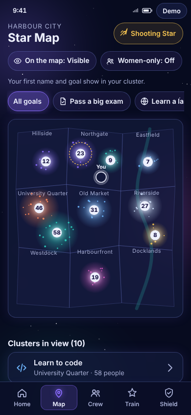
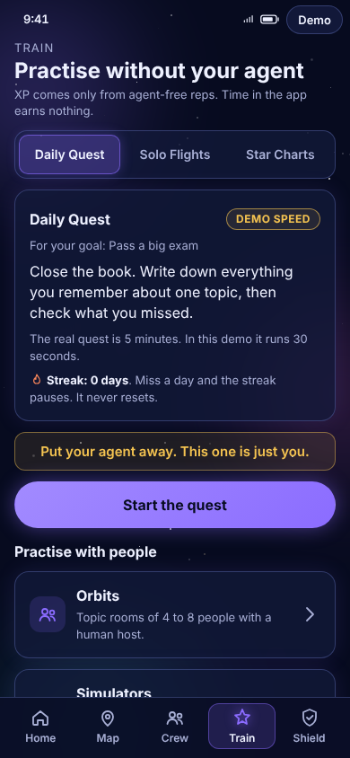
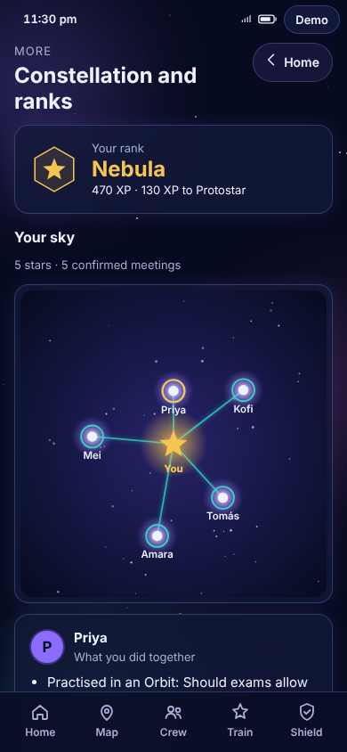
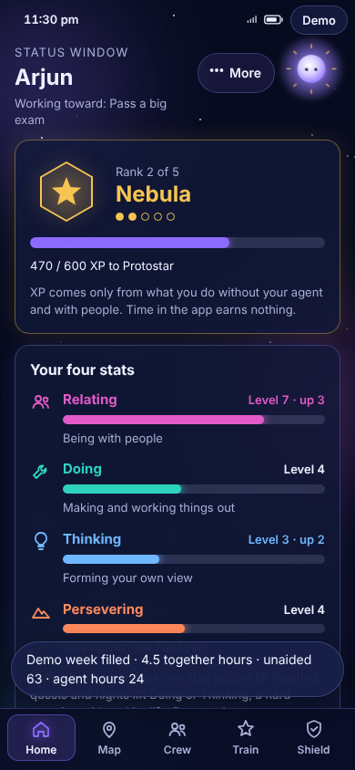
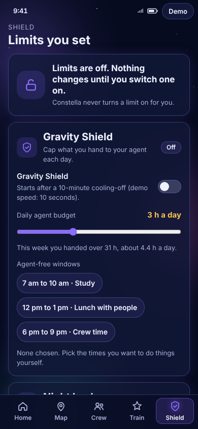
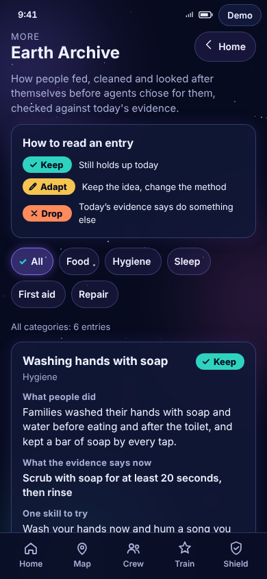

# ✦ CONSTELLA

### Stay able, together.

**Practise independently. Find your people. Choose when to put your agent away.**

[**Explore the live demo →**](https://ayanshs007.github.io/Constella-prototype/) · [**Download the offline prototype ↓**](https://github.com/ayanshS007/Constella-prototype/raw/refs/heads/main/Ayansh_Shankar_Yadav_IIT_Kanpur.zip)

HTML · CSS · JavaScript &nbsp; | &nbsp; No installation &nbsp; | &nbsp; Runs offline

<table>
<tr><th>Find your people</th><th>Build your capability</th><th>Grow your constellation</th></tr>
<tr>
<td width="33%"></td>
<td width="33%"></td>
<td width="33%"></td>
</tr>
</table>

*Actual prototype screenshots from development milestones. People, places and progress are fictional demo data; some screens show an earlier demo clock or layout.*

[The idea](#the-idea) · [Product tour](#product-tour) · [Try it](#try-it) · [Demo walkthrough](#demo-walkthrough) · [Under the hood](#under-the-hood) · [Prototype boundaries](#prototype-boundaries)

## The idea

Imagine 2040: personal AI agents handle everyday tasks, rehearse conversations and help people prepare for almost anything. But an exam, an interview or a first meeting can still demand something the agent cannot supply: **your own ability, in the moment, with other people.**

Constella explores how a product could help people keep that ability in practice. Choose a goal, find a nearby crew, practise without assistance, and turn shared activity into visible progress. Goals range from passing an exam and landing a job to learning a language, cooking and getting fit together.

The central product hypothesis: **small independent efforts become easier to sustain when people practise together and can see their own progress.** This prototype demonstrates the experience; it does not establish that hypothesis through measured user outcomes.

The space theme carries the story. Convenience is a gravity well; practice and real meetings give you thrust. **Lumen**, the glowing companion, responds to activity without speaking. Your **Constellation** records the people you have met, practised with or taught.

## Product tour

| Experience | What you can explore | Purpose |
| --- | --- | --- |
| **Awakening & Home** | Choose a goal and visibility; complete four checks; see your Status Window and comparison with your past self. | Establish a starting point and make progress visible. |
| **Star Map & Crew** | Browse clusters of five or more, filter by goal, use a women-only view, open chats and try a crew check-in. | Connect shared intent to a plan to meet. |
| **Train** | Daily Quests, timed Solo Flights with paper-photo previews, and Star Charts that ask for an answer before revealing hints. | Make independent effort part of the experience. |
| **Orbits & Simulators** | Write a three-line view before entering a room; practise an interview, short talk or hard conversation with sample peer feedback. | Bring your own thinking into practice with people. |
| **Shield & Night Watch** | Explore optional budgets, agent-free windows, Night Lock, cooling-off and crew-approved exceptions; visit quiet night rooms. | Demonstrate user-chosen boundaries. |
| **Earth Archive** | Six Keep / Adapt / Drop entries, source labels and Elder Signals recipe cards. | Connect everyday skills with evidence and intergenerational learning. |
| **Light Exchange & Missions** | Book learning or teaching in hours; rate a session; complete shared missions through the crew scan flow. | Reward contribution and activities that require another person. |
| **Constellation & Privacy** | Explore people and meeting lines, view ranks, change visibility or reduced motion, and delete demo progress. | Make relationships visible while keeping controls accessible. |

**Shooting Star** adds spontaneous public activities happening in the next two hours. The main tabs are **Home · Map · Crew · Train · Shield**. Home's **More** menu opens the Archive, Exchange, Missions, Constellation, Night Watch and settings.

<strong>See more screens: Home, Shield and Earth Archive</strong>

<table>
<tr><th>Status Window</th><th>Limits you set</th><th>Earth Archive</th></tr>
<tr>
<td width="33%"></td>
<td width="33%"></td>
<td width="33%"></td>
</tr>
</table>

[Browse the complete screenshot gallery](screenshots/).

## Progress that follows action

Four stats track **Relating, Doing, Thinking and Persevering**. Practice, meetings and teaching nudge the relevant stat. A missed Daily Quest pauses the streak instead of resetting it. **Time spent in the app earns no XP.**

| Action | Prototype XP |
| --- | ---: |
| Daily Quest | 20 |
| Solo Flight | 30 |
| Simulator session | 40 |
| Confirmed crew meeting | 50 per hour |
| Teaching | 60 per hour |
| Landing Mission | 80 |

The rank ladder is **Stardust → Nebula → Protostar → Star → Supernova**, at 0 / 200 / 600 / 1,500 / 3,000 XP. Supernova also requires five teaching hours. These are prototype thresholds, not validated measures of ability.

Rank-ups trigger **Ascend**, a 1.4-second light burst. Reduced motion replaces the burst with a text notification. Lumen brightens with activity and dims gently after inactivity; it never becomes a chat interface.

## Try it

**In your browser:** [open Constella](https://ayanshs007.github.io/Constella-prototype/).

**Offline, with no installation:**

1. [Download the submission ZIP](https://github.com/ayanshS007/Constella-prototype/raw/refs/heads/main/Ayansh_Shankar_Yadav_IIT_Kanpur.zip).
2. Extract the entire folder. Keep `index.html`, `css/` and `js/` together.
3. Double-click `index.html` to open it in a browser with JavaScript enabled.
4. Select **Begin your Awakening**, or use **Demo controls** to jump to a screen.

The app is designed to open directly from `file://`; no terminal, local server, account or API key is required. [README.txt](README.txt) contains the short instructions included in the submission package.

On desktop, the app sits inside a phone frame with controls alongside it. On a narrow window, tap **Demo** to open those controls.

## Demo walkthrough

Use this sequence for a short presentation. Demo controls let you prepare each scene without completing every timer on camera.

| Scene | What to show |
| --- | --- |
| **1. Start with yourself** | Reset the demo, open Welcome, choose a goal and complete the Awakening. |
| **2. Find your people** | Open Map, choose a cluster and try the hold-to-confirm chat entry. |
| **3. Turn intent into a meeting** | Open Crew and simulate a two-sided code check-in. |
| **4. Practise independently** | Try a Solo Flight, then open an Orbit and write three lines to enter. |
| **5. Choose a boundary** | Turn on Night Lock in Shield, then select **Set time to 11:30 pm** in Demo controls. |
| **6. Connect with everyday skills** | Open Earth Archive from More and explore an entry or recipe mission. |
| **7. See the proposed payoff** | Select **Fill a demo week**, inspect Home, then open Constellation. Use **Trigger Ascend** to replay the rank moment. |

**Fill a demo week** sets an illustrative progression from a fresh reset:

| Weekly indicator | Starting state | Filled demo week |
| --- | ---: | ---: |
| Together hours | 0.5 h | 4.5 h |
| Unaided score | 54 | 63 |
| Hours handed to the agent | 31 h | 24 h |
| Rank | Stardust | Nebula |

These are **scripted demonstration values, not observed improvements or automatically measured agent usage**. Reset before repeating the sequence. The Motion switch is useful for a still presentation; Reset demo clears the current run.

## Under the hood

Plain HTML, CSS and JavaScript power the app. Ordered `defer` scripts share the `window.C` namespace; hash routes switch screens. There are no JavaScript modules, package dependencies, CDN assets, runtime data fetches or AI model calls.

| File or folder | Responsibility |
| --- | --- |
| `index.html` | App shell and ordered script loading |
| `css/` | Styles, responsive layout, motion and local background asset |
| `js/data.js` | Fictional people, goals, rooms, content and rank thresholds |
| `js/state.js` | Demo state, persistence, awards and progress |
| `js/ui.js` / `js/game.js` | Shared UI helpers, Lumen reactions and Ascend |
| `js/screens*.js` | Onboarding, Home and the feature screens |
| `js/app.js` | Hash router, navigation, demo controls and reset |
| `screenshots/` | Development screenshots used in this README |
| [PLAN.md](PLAN.md) | Original build specification, milestones and QA checklist |

To work on the source, clone this repository and open `index.html`. Preserve plain-script loading order and relative asset paths so the offline version continues to work.

The repository includes development materials. The submission ZIP is a separate, minimal package containing `index.html`, `README.txt`, `css/` and `js/`.

## Prototype boundaries

Constella is a **single-browser interactive prototype**, built as a visual aid for a product case submission.

- **Social interactions are simulated.** Chats, peer marks, room participants, approvals, ratings and code scans do not connect to real users. The hold gesture illustrates an interaction; it does not verify human identity or prevent agent access.
- **Shield demonstrates a proposed flow.** It does not control another app, block purchases, read an agent's data or enforce device limits. Real enforcement would require supported platform integrations.
- **Progress is local.** Demo state uses guarded `localStorage`, with an in-memory fallback if storage is blocked. There is no account or cross-device sync. A Solo Flight photo preview stays in memory and is not uploaded or saved.
- **Content is illustrative.** Earth Archive entries carry source names and a “Prototype content: verify before launch” note. Sample peer-review and licence labels demonstrate the interface, not a live review system.
- **Accessibility controls are included.** Keyboard focus styles, labelled controls and reduced motion are implemented. See [the validation checklist](PLAN.md#11-checks-before-packaging); this README does not claim independent accessibility certification or universal browser compatibility.

Use **More → Privacy & settings → Delete everything** to clear the prototype's saved progress and return to Welcome. **Reset demo** also starts a fresh run. When storage is unavailable, progress lasts only for the current session.

---

**Built by [Ayansh Shankar Yadav](https://github.com/ayanshS007) · IIT Kanpur**

*Constella — Stay able, together.*

